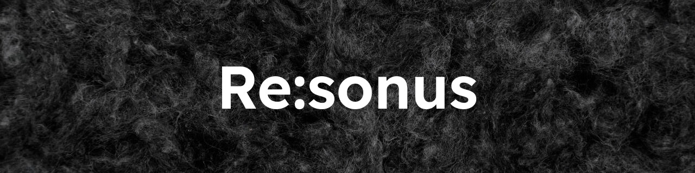
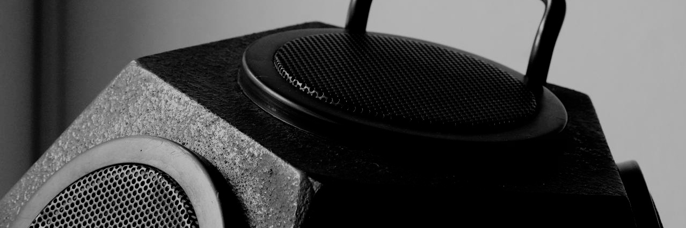
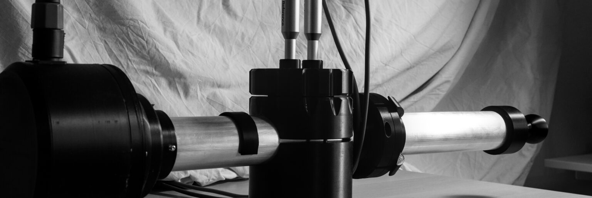
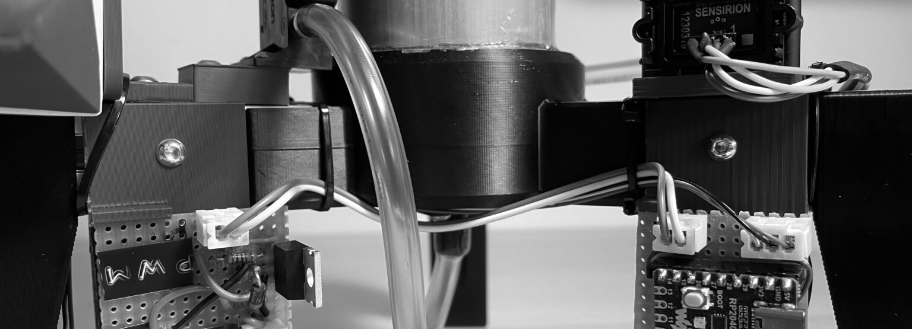

  

  <strong>Spaces that reflect your vision. Materials you can hear.</strong> 
  Room and building acoustics consultancy and development of sound-absorbing materials.

  <a href="https://resonus.cz/en/index/">Website</a> ·
  <a href="https://resonus.cz/en/references/">References</a> ·
  <a href="https://resonus.cz/en/about/">About</a>

We are experts in acoustics. We combine research and development with engineering expertise to ensure that every solution we design is in tune with your needs.

## Room acoustics

Whether it is the noise level in an office, speech intelligibility in a classroom, or listening conditions in a recording studio, we are here for you. Our designs incorporate acoustic materials from established manufacturers, and we also use unconventional or DIY solutions when the situation requires them.

## Structural acoustics

Thoughtful design of walls, floors, building assemblies, and the details that connect them can significantly improve acoustic performance, both in new construction and in the renovation of buildings originally designed for other uses.

## Development and characterization of acoustic materials

We measure sound absorption coefficients with an impedance tube according to ISO 10534-2, which allows testing on small samples at relatively low cost. For a deeper understanding of porous materials, we also offer measurements of airflow resistivity (ISO 9053-1), porosity, and ultrasonic tortuosity.

## Design and custom production of measurement setups

Our measurement systems combine parametric design, precision aluminium profiles, and 3D printing, resulting in cost-effective setups that are straightforward to customize. We currently manufacture impedance tubes and airflow resistivity measurement setups, and we are developing a setup for measuring open porosity and tortuosity.

## Open source

Our Python-based measurement software builds on our openly published in-house code:

- [imptube](https://github.com/vyhyb/imptube)
- [flowres](https://github.com/vyhyb/flowres)
